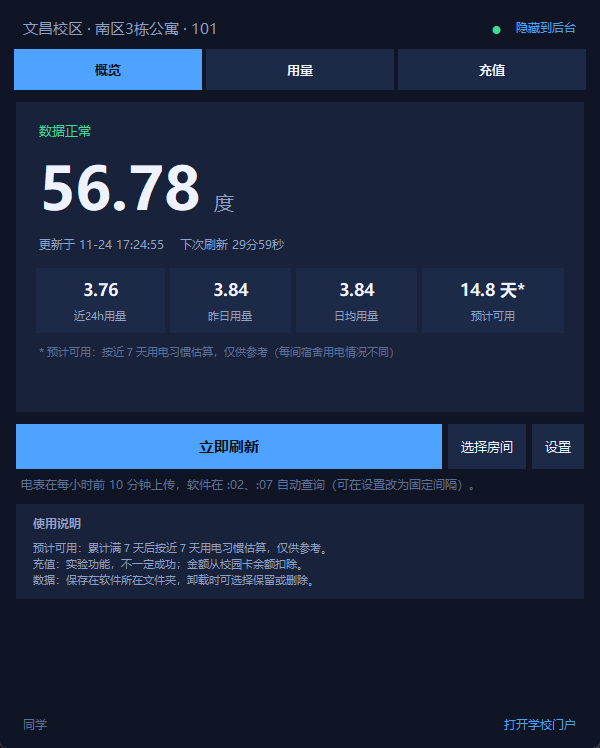

# GXUST电费助手

Windows 桌面工具：查询广西科技大学「掌上电控」宿舍剩余电量，查看用量统计和预计可用天数，支持托盘后台与充值入口。

> 本软件完全免费开源。如需付费或来自来路不明的渠道，请立即删除。
> 
> 作者 qq:3104666011
> GitHub:[@smg123233](https://github.com/smg123233)
>
> 免责声明：本软件与广西科技大学、贵阳瑞博科技有限公司无关，仅供学习使用。只读取本人账号有权查看的数据，不绕过学校权限、不代管资金。



## 下载与安装

- 推荐 `GXUSTPower-1.0.1-Setup.exe`，也可使用 `GXUSTPower-1.0.1.msi`；
- 便携版 `GXUSTPower-1.0.1-portable.exe`，单文件，会请求管理员权限，数据保存在 `%LOCALAPPDATA%\GXUSTPowerPortable`；
- 安装时可选择安装位置，并勾选是否创建桌面快捷方式；卸载使用安装目录下的 `uninstall.exe` 或 Windows「应用和功能」；
- 覆盖升级：直接运行新版本的 Setup.exe / MSI 即可，会自动替换旧版本并保留账号和历史数据，无需先卸载；
- 安装包未签名，SmartScreen 提示时选择「更多信息 → 仍要运行」。

## 首次使用

1. 阅读并勾选使用条款；
2. 填写学校账号和密码（初始密码为 Aa@身份证后六位，X 用数字 0 代替；改过密码请填新密码）；
3. 验证通过后选择自己的宿舍。

账号和密码只保存在本机，密码使用 Windows DPAPI 加密，软件不内置任何账号。

## 功能

- 剩余电量、更新时间、预计可用天数（满 7 天数据后估算，仅供参考）；
- 日 / 月 / 年用量条形图与最近 7 天余额曲线；
- 低电量提醒、托盘后台、开机通知；
- 充值入口（实验功能，金额从校园卡余额扣除，不自动重试）；
- 设置查询节奏、低电量阈值、开机启动和关闭行为。

## 数据与安全

- 数据保存在软件目录的 `config.json` 和 `data\`；目录不可写时回退到 `%LOCALAPPDATA%\GXUSTPower`；
- 充值导致的余额上升不计入用电量；
- 充值结果以学校系统为准，软件不代管资金。

## 开发

```bat
pip install pystray pillow qrcode
python app.py
```

- 构建：`powershell -ExecutionPolicy Bypass -File build.ps1`
- 测试：`python -m unittest discover -s tests`

产物在 `dist\`：主程序、MSI、Setup.exe、单文件便携版。

## 免责声明

本软件完全免费开源，与广西科技大学、贵阳瑞博科技有限公司无关，仅供学习使用。电量、预计可用、充值记录等数据仅供参考；因学校接口调整、网络故障或数据延迟造成的任何影响，作者不承担责任。请遵守学校网络与信息系统使用规定，不要频繁刷新或恶意调用接口。软件部分代码由AI生成。
